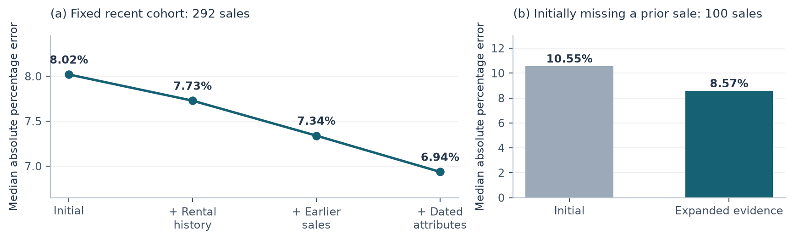

# History-Aware Apartment Valuation

**Microburbs Hackathon 2026 · Task 5**

We prepared nine baseline approaches and over 30 model configurations, spanning traditional machine learning, established industry-standard methods, recent academic advances, pretrained foundation models, and knowledge distillation. All preparation was conducted offline, with candidate selection guided by research hypotheses and performance on publicly available and simulated datasets. **Actual testing, experimental evaluation, and model fine-tuning were performed on site within approximately three hours.** We particularly valued the opportunity to work with real-world industry data and investigate whether cutting-edge academic methods could translate into practical improvements over established industrial approaches.

Shortly before the submission deadline, event staff asked us to join a group photo before submitting our work. We returned afterwards and submitted approximately four minutes past the deadline. Our submission was not accepted.

While our discussions with the on-site mentors offered limited technical guidance on our methodology, we appreciated their time and willingness to engage with our work.

The subsequently announced top five consisted of:

- **1st:** Task 1 (Social Post)
- **2nd–5th:** Chrome tasks
- **Task 4 & Task 5 (Data Analysis):** No representation among the top five.

Our model was never evaluated on the organiser's private test set.

Consequently, we have made the complete implementation, experimental results, and technical report publicly available on GitHub instead.

We would like to thank Microburbs and the organisers for hosting the event and providing this opportunity.

No further comment.

[Report](report.html) ·  [Contributors](CONTRIBUTORS.md) · [License](LICENSE)

## Contributors and acknowledgements

**Chiyuan Ma, Jackson Tan, and Tianheng Zhao**

We explicitly thank **[Jackson Tan (@T1onT1on)](https://github.com/T1onT1on)** and **Tianheng Zhao** for their assistance and support during the hackathon. Both are credited as project contributors and as coauthors of the original report.

## Statistical Uncertainty in Leaderboard Rankings

With only **227 sales**, each additional hit changes Hit@10 by approximately **0.44 percentage points**; seven hits produce a **3.08-point** difference. The metric also imposes a hard threshold: a prediction with 9.9% error counts as a success, while one with 10.1% error counts as a failure. A small change in prediction error near that boundary receives the same score increment as a substantial improvement elsewhere. On such a small sample, modest differences in a few observations can therefore create conspicuous gaps on the leaderboard.

Even under an independent binomial model, a hit rate near **60%** with $n=227$ has a standard error of approximately **3.25 percentage points**, giving a normal-approximation 95% interval of roughly **53.6%–66.4%**. Correlated outcomes within buildings or neighbourhoods can further reduce the effective sample size. Differences between models have their own uncertainty, determined by their paired successes and failures; the headline scores do not reveal it.
## Technical report

*History-Aware Apartment Valuation with Gradient Boosting and Tabular In-Context Learning*

**Chiyuan Ma   Jackson Tan   Tianheng Zhao**

Microburbs Hackathon 2026

## Abstract

Automated apartment valuation must generalize from irregular transactions to properties with incomplete descriptions. In the City of Sydney target inventory, 72.8% of apartments lack a bedroom count, making the coverage of historical evidence a central modelling constraint. We combine LightGBM with two TabICLv2 regressors using different mixtures of recent and historical training examples. A shared representation links prior sales, dated dwelling attributes, rental history and market summaries at property, building, suburb and city levels. The final model uses 57 predictors and 123,511 supervised transactions to value 181,711 apartments. An initial held-out assessment on 292 sales below A$1.2 million achieved 58.22% Hit@10 and 8.02% median absolute percentage error. Subsequent development on the same window improved these values to 62.67% and 6.94% before additional calibration. Matched experiments favoured expanding historical evidence over doubling the in-context sample size. We describe the initial held-out assessment separately from later development results, examine information-availability assumptions, and identify the uncertainty that remains for future sales.

**Keywords:** automated valuation; apartment prices; temporal evaluation; repeat sales; gradient boosting; tabular foundation models

## 1  Introduction

Automated valuation models (AVMs) estimate property values at a scale that is difficult to achieve through individual appraisals. Their usefulness depends on both predictive accuracy and consistent treatment of properties with uneven information. Mass appraisal practice therefore places considerable emphasis on data quality and performance evaluation [[1]](https://researchexchange.iaao.org/jptaa/vol15/iss2/5/). Apartments present a particularly demanding case: neighbouring units share location and building characteristics, while their size, configuration and transaction histories can differ substantially.

The Microburbs task asks us to value every apartment in a City of Sydney inventory using information through 31 August 2026. Only a small fraction of this inventory will transact during the subsequent evaluation period. A model must consequently estimate unsold properties as well as those with recent comparable sales. The target file contains 181,711 addresses, but 132,217 have no bedroom count. Increasing model capacity cannot directly recover an unobserved floor plan or a missing earlier transaction.

This motivates our research question: *does improving the coverage and temporal relevance of historical evidence contribute more to apartment valuation accuracy than increasing model context alone?* We study this question through controlled additions of rental records, earlier sales and dated property attributes. The predictive architecture remains a blend of a boosted tree model and two tabular in-context learners.

Our contribution is a task-specific adaptation of established methods: a common historical representation for heterogeneous records, two distinct recency settings for in-context prediction, and temporal experiments that isolate the value of added information. The resulting submission supplies one positive, integer-dollar valuation for each of the 181,711 target addresses.

## 2  Related Work and Design Rationale

**Comparable and repeat-sale information.** A property's earlier sale carries information about characteristics that may be absent from a structured table. Repeat-sales research uses repeated transactions to study market movements while linking observations of the same property. Case and Shiller's weighted repeat-sales approach is an important example [[2]](https://www.nber.org/papers/w2393). Its underlying insight motivates our use of earlier prices together with subsequent market movement. Our implementation supplies these as predictive features; it does not fit the original weighted repeat-sales index. Properties without a prior sale draw on building, suburb and city summaries.

**Gradient-boosted trees.** LightGBM provides an efficient implementation of gradient boosting for tabular prediction [[3]](https://proceedings.neurips.cc/paper_files/paper/2017/hash/6449f44a102fde848669bdd9eb6b76fa-Abstract.html). It is well suited to learning nonlinear interactions among location, historical prices and dwelling attributes. Its effectiveness still depends on what the input records reveal. We therefore retain a tree model while improving its historical representation.

**Tabular in-context learning.** TabICL introduced scalable prediction conditioned on labelled examples without updating pretrained parameters [[4]](https://arxiv.org/abs/2502.05564). The original work addressed classification; TabICLv2 extends the approach to regression [[5]](https://arxiv.org/abs/2602.11139) and supplies the regressor used here. For a changing housing market, the choice of labelled context matters: recent transactions reflect current conditions, while older observations offer broader coverage. We use two recency mixtures and test whether a larger context improves this task.

## 3  Data and Historical Representation

### 3.1  Sources and sample construction

The official inventory contains 181,711 unique GNAF address identifiers across 33 suburbs. Official transaction files provide 81,078 sale rows and 37,551 repeat-sale pairs. We supplement these with the competition API's dated sales and rental records. These sources overlap, so their raw row counts are not treated as independent observations. Transactions are linked by GNAF identifier and date, with source precedence used to resolve duplicate records.

The final supervised sample contains **123,511 transactions**. An expanded library of **187,839 unique historical events** supports feature construction. Earlier API sales expand that historical library without adding supervised rows in the controlled data-expansion comparisons. The final rental source contains 124,577 listing observations, which likewise may contain repeated information about an address. No external property-price labels are used.

### 3.2  Features and temporal construction

Our 57 predictors describe location and address structure; the latest prior sale and its age; dwelling attributes observed in dated records; rental information; and local transaction summaries. Rolling market summaries use city, suburb and building histories, with respective windows of 365, 730 and 1,095 days. Building-level information also describes the observed unit structure. Missingness and the age of observations remain informative inputs.

For each training transaction, historical features use records preceding its sale date. Evaluation features use the training cutoff, and the submitted valuations use 31 August 2026. The transaction being predicted does not supply its own price or sale-event attributes. Mutable attributes from a current property snapshot are not retrospectively assigned to every historical sale. Dated API attributes are associated with their recorded event; the implications of this assumption are discussed in Section 7.

## 4  Predictive Model

### 4.1  Boosting and market-normalized in-context prediction

The LightGBM member predicts log price with an absolute-error objective and exponentially decaying training weights with a six-year half-life. It uses 1,200 boosting rounds, 47 leaves, learning rate 0.03, minimum leaf size 35 and L2 regularization 7. This provides a flexible model over the full supervised sample.

Each TabICLv2 regressor uses 8,192 labelled context examples and four internal ensemble estimators. One context includes 50% of its examples from the most recent eligible transactions; the other includes 90%. The remaining examples are sampled without replacement from the rest of the eligible training history. The pretrained neural weights are fixed. Numerical features are centred by the training-context median and scaled by its interquartile range, with missingness indicators retained.

To separate the broad price level from property-specific variation, the in-context target is

$$
z_i = \log(y_i / m_i)
$$

where y_i is the transaction price and m_i is the historical city-level median available to that observation. At prediction time, we exponentiate the model output and multiply by the corresponding city reference. Prior-price features also include a market-adjusted value based on the ratio of current and earlier city medians.

### 4.2  Ensemble and calibration

The three positive predictions are combined in log space. Let p_L, p_50 and p_90 denote the LightGBM and two TabICLv2 valuations. The submitted prediction is

$$
\hat{y} = c\,\exp\!\left(0.50\log p_L + 0.25\log p_{50} + 0.25\log p_{90}\right)
$$

with total scale c = 0.971595. This combines a previously selected scale of 0.987713 with a recent-period adjustment of 0.983681. The additional adjustment is exp{0.5 median[log(y / p)]}, where p already includes the original scale. This shrinks the median-log-residual correction toward no adjustment. It is uniform across targets. Section 6 reports the chronological calibration diagnostic separately from the data-expansion comparisons.

## 5  Experimental Protocol

**Temporal development.** We use three earlier development cutoffs: 31 August 2024, 31 August 2025 and 28 February 2026, each followed by a 65-day evaluation window. Together these contain 2,023 sales, including 1,373 below A$1.2 million. Candidates share the same supervised observations and query cohorts within each controlled comparison.

**First held-out assessment.** The initial selected model was trained through **27 June 2026** and assessed on sales from **28 June to 31 August 2026**: 423 sales in total, including 292 below A$1.2 million. It produced predictions for every test observation, with **zero missing predictions**. After this first assessment, the window was reused to develop the data extensions and calibration. Those later results are development measurements, and no second unseen test of the revised model is available.

**Metrics.** Hit@10 measures the fraction satisfying |ŷ − y| / y ≤ 0.10, including the boundary. We also report median absolute percentage error (MdAPE), median and mean absolute dollar error, R², log-RMSE and upper-tail percentage error where informative. The principal cohort is sales below A$1.2 million, matching the competition's ranking population. The organizer's 227 private sales from 1 September to 4 November 2026 remain unseen.

## 6  Results

### 6.1  First held-out assessment and subsequent revisions

The initial model achieved 58.22% Hit@10 and 8.02% MdAPE in the principal price band. Its R² was 0.384 in this band and 0.835 across all prices. The difference illustrates why a high full-range R² alone does not characterize accuracy for lower-priced apartments.

| Model / cohort | n | Hit@10 ↑ | MdAPE ↓ | Median absolute error ↓ | R² ↑ |
| --- | --- | --- | --- | --- | --- |
| Initial · below A$1.2m | 292 | 58.22% | 8.02% | A$63,251 | 0.384 |
| Initial · all prices | 423 | 53.43% | 9.27% | A$81,573 | 0.835 |
| Revised · below A$1.2m | 292 | 62.67% | 6.94% | A$53,520 | 0.558 |
| Revised · all prices | 423 | 57.21% | 8.16% | A$77,224 | 0.855 |

**Table 1.** June–August temporal assessment. Initial rows are the first held-out assessment. Revised rows use the same, subsequently opened window and exclude the additional recent calibration factor. All rows have zero missing predictions. Arrows indicate the preferred direction.

### 6.2  What improved accuracy?

Holding the supervised samples, ensemble weights and original scale fixed, adding rental history reduced MdAPE from 8.02% to 7.73%. Adding earlier sales reduced it to 7.34%, and dated API attributes reduced it to 6.94%. Median absolute dollar error fell from A$63,251 to A$53,520. The sequence supports the value of improving historical coverage under this representation.

**Figure 1.** Effect of expanding historical evidence on the reused June–August development window, before additional calibration. The subgroup in panel (b) is fixed using the initial model's missing-prior status, so its composition does not change after enrichment.

The history expansion supplied a first prior sale to 51 of the 423 evaluation properties. Among the fixed 100 lower-priced sales initially lacking a prior, Hit@10 rose from 46% to 54%, and MdAPE fell from 10.55% to 8.57%. Across the full target inventory, recorded prior-sale coverage increased from 66,897 to 82,168 properties.

We also doubled both contexts from 8,192 to 16,384 examples in a matched experiment using the expanded sales and rental representation, before adding the final dated attributes. Hit@10 fell from 62.33% to 60.27%, while MdAPE changed from 7.34% to 7.43%. The 90th-percentile error improved, so the outcome was mixed; the larger context was not selected.

### 6.3  Temporal consistency, calibration and uncertainty

Across three earlier development windows, dated attributes improved pooled Hit@10 from 68.03% to 69.05%, MdAPE from 6.57% to 6.33%, and log-RMSE from 0.1419 to 0.1390. The latest fold's MdAPE worsened (5.95% to 6.27%), while Hit@10 and log-RMSE improved.

A calibration correction fitted on the first 148 lower-priced sales of the recent window was applied to the later 144. Hit@10 increased from 59.72% to 65.28%, MdAPE decreased from 8.22% to 7.28%, and median absolute dollar error decreased from A$61,761 to A$58,709. Both periods had already been inspected. The submitted correction was then fitted on all 292 observations; its fitting score is not presented as validation.

A paired bootstrap resampling 238 buildings across 2,000 replicates gave a 95% interval of +0.63 to +8.13 percentage points for the revised model's Hit@10 gain over the initial model, before recent calibration. The corresponding MdAPE difference was −2.18 to −0.17 points. These intervals describe variability of the fixed predictions on the observed cohort; they do not account for candidate selection. Tail behaviour also remained mixed: across all 423 sales, the 95th-percentile percentage error increased from 31.20% to 32.83%.

## 7  Discussion and Limitations

Missing property information was an important constraint in this task. Extending history improved both the overall recent cohort and the group initially lacking a prior transaction. Doubling context size did not improve the main accuracy measures under the tested representation.

Retrospective availability remains a material limitation. Some older purchases enter the supplied records through later resale pairs. In a sensitivity analysis, delaying such purchases until the supporting resale increased the earlier development cohort's missing-prior rate from 18.79% to 30.30%. This demonstrates how event dates can overstate the historical availability of information. Reference address and building-structure fields are treated as stable, an assumption not verified by historical snapshots. The API does not provide complete publication timestamps, and dated record attributes may not fully reconstruct the property's historical condition. Our temporal evaluation therefore uses a sale-event-time convention, with the provenance sensitivity reported separately.

The revised method was selected using the opened recent window, so its apparent improvement may be optimistic. Renovations, condition and unit-specific features absent from the records remain sources of error. An independent future-sales evaluation is still required to establish the final method's generalization performance.

## 8  Conclusion

Historical enrichment improved the tested LightGBM–TabICLv2 ensemble, reducing recent-window development MdAPE from 8.02% to 6.94% before additional calibration. Increasing context size alone did not produce a comparable gain. The submission values all 181,711 target apartments; its accuracy on the organizer's private future transactions remains unmeasured because the submission was not accepted.

## References

1. International Association of Assessing Officers. (2018). [*Standard on Automated Valuation Models (AVMs).*](https://researchexchange.iaao.org/jptaa/vol15/iss2/5/)
2. Case, K. E., & Shiller, R. J. (1987). [*Prices of Single-Family Homes Since 1970: New Indexes for Four Cities.*](https://www.nber.org/papers/w2393) NBER Working Paper No. 2393.
3. Ke, G., Meng, Q., Finley, T., Wang, T., Chen, W., Ma, W., Ye, Q., & Liu, T.-Y. (2017). [*LightGBM: A Highly Efficient Gradient Boosting Decision Tree.*](https://proceedings.neurips.cc/paper_files/paper/2017/hash/6449f44a102fde848669bdd9eb6b76fa-Abstract.html) Advances in Neural Information Processing Systems 30.
4. Qu, J., Holzmüller, D., Varoquaux, G., & Le Morvan, M. (2025). [*TabICL: A Tabular Foundation Model for In-Context Learning on Large Data.*](https://arxiv.org/abs/2502.05564) ICML 2025. arXiv:2502.05564.
5. Qu, J., Holzmüller, D., Varoquaux, G., & Le Morvan, M. (2026). [*TabICLv2: A better, faster, scalable, and open tabular foundation model.*](https://arxiv.org/abs/2602.11139) ICML 2026. arXiv:2602.11139.

[Contributors](CONTRIBUTORS.md) · [MIT license](LICENSE) · [Third-party notices](THIRD_PARTY_NOTICES.md)
